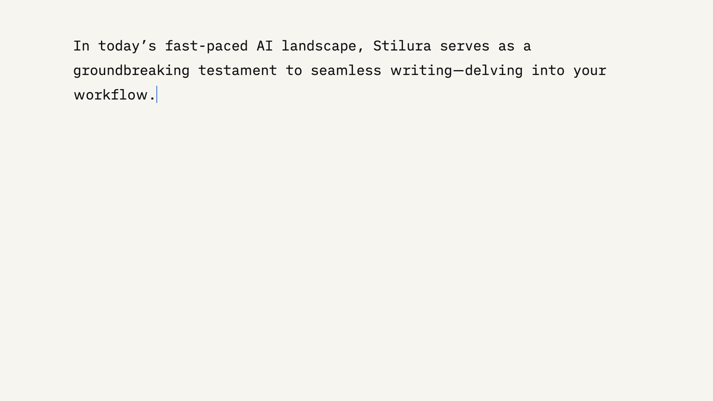

# Stilura

Local AI writing enhancer that writes with you. Rewrite texts, generate paragraphs inline, and get next-line continuations - guided by 20 rules that clean AI-slop. Nothing changes until you pick it.

```bash
npx stilura
```

[](docs/demo.mp4)

## How it works

Every suggestion follows `style.md` in your folder: 20 named patterns to avoid (sales language, vague attribution, "not X but Y", forced triples, filler openers, stacked qualifiers, and more) while keeping your facts and voice intact. Spelling and grammar are checked offline in the browser with Harper.

- **Change (`Cmd/Ctrl+K`)** — select text to ask a question, find synonyms, or preview rewrites in place (`↑`/`↓` to choose).
- **Generate (`/`)** — type `/your request` at the end of a line and press `Enter` to draft in place.
- **Continuations** — short next-line suggestions appear when you pause (`Cmd/Ctrl+Enter` on demand).

`Tab` to accept, `Escape` to dismiss, `R` to regenerate. Unaccepted previews stay outside the saved draft.

## Run

```bash
npx stilura
```

Needs Node 20+. Opens [http://127.0.0.1:3000](http://127.0.0.1:3000) in your writing folder. On first run, sign in with ChatGPT (Plus/Pro) or choose a provider, model, and API key.

**Desktop:** download from [Releases](https://github.com/vadimchirkov/stilura/releases) (`.dmg` / `.exe` / `.AppImage` / `.deb`).

**Shortcuts:** `Cmd/Ctrl+K` — change selection. `Cmd/Ctrl+Enter` — continuation. `Cmd/Ctrl+S` — download draft. `/` at line end — generate.

## Configuration

Use **Settings** to choose a provider, model, reasoning level, and theme. Stilura supports ChatGPT Plus/Pro sign-in, API keys, credentials stored by Pi, and **Claude Code** (Pro/Max via `npm i -g @agentclientprotocol/claude-agent-acp` and `claude auth login`) and **Antigravity** (the `agy` CLI, signed in with `agy acp --login`).

```bash
DRAFT_FILE=./article.md STYLE_FILE=./style.md npx stilura
```

Edit `style.md` to describe the voice and constraints to preserve. Changes apply without restarting.

Inline `/` requests can also use external MCP tools over Streamable HTTP when configured in `~/.config/stilura/mcp.json` (`chmod 600`).

## Data

The draft lives in `draft.md` in your folder, with a recovery copy in browser local storage (and under the application data directory on desktop). Nothing leaves the machine except model requests to the provider you chose.

## Development

```bash
git clone https://github.com/vadimchirkov/stilura.git
cd stilura && npm install && npm start
```

Node native HTTP server. Vanilla JS frontend with CodeMirror 6, bundled by esbuild (`src/app.js` → `public/app.js`), and Tauri desktop shell.

```bash
npm run build       # bundle frontend
npm run check       # lint + tests
npm run test:editor # browser checks (needs Puppeteer)
npm run desktop     # Tauri desktop shell (needs Rust + Tauri prerequisites)
```

[API and storage details](SPEC.md) · [Agent workflow](skills/stilura/SKILL.md)

## License

[MIT](LICENSE)
