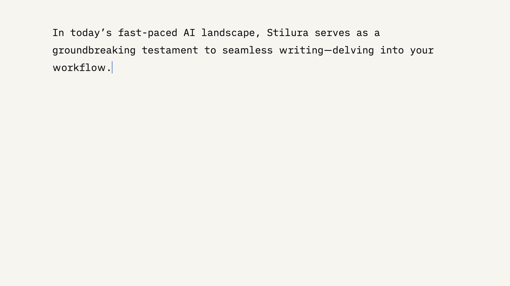

# dev.to article

> **Before posting:** HN, DEV and several subreddits remove AI-written posts. This draft was reworked to sound less generated, which lowers the risk but doesn't remove it. Reword it yourself before you post, then set DEV's disclosure honestly ("Hand Written" only if it is).

Notes for publishing:

- DEV says AI-assisted articles should not promote your own product. If after your edit you can't honestly call this hand-written, cut the promo or post it elsewhere.
- Sentences marked [confirm] are about your own habits or reasons. Keep them only if they're true.
- Tags: `writing`, `opensource`, `markdown`, `ai`. Cover image: `docs/marketing/assets/og-image.png`. Body GIF: `https://raw.githubusercontent.com/vadimchirkov/stilura/main/docs/demo.gif`.

---

# My editor's test paragraph is AI slop, on purpose

This is the paragraph I test Stilura with:

> In today's fast-paced AI landscape, Stilura serves as a groundbreaking testament to seamless writing—delving into your workflow.

I wrote it badly on purpose, as a test. It packs in the landscape, "serves as a testament", "seamless", an em dash and a "delving" tacked on the end.

Here's where it ends up:

> Stilura is a local Markdown editor where you keep the last word.

It takes two requests. I select the whole sentence, press `⌘K` and type "kill the AI slop. say what it actually is." That gives "Stilura is a local Markdown editor where AI suggests and you decide." Better, but the end is soft. So I select only "where AI suggests and you decide.", press `⌘K` again, type "sharper", press `↓` twice to reach the third option and keep it with `Tab`.

A caveat, since it matters for a post like this. The GIF in the README is a scripted animation of that exact flow. The options in it are fixed text; no model wrote them. In the real app the model writes the options, and you'll get different ones.



## Why it lives in the document

My old way was a chat tab. Copy a paragraph over, ask for "a bit shorter", get back something shorter that also changed a number and added "Moreover", copy the one sentence I liked, paste it back, fix the formatting. [confirm]

The model wasn't really the problem. The chat was. It answers for the whole passage, and each answer replaces the last one. I wanted the edit to happen on the words I selected, with a few versions to flip through or ignore, and my file to stay put until I said so.

So `⌘K` (`Ctrl+K` on Windows and Linux) works on a selection, and `↑`/`↓` moves between what comes back. A `/` at the end of a line plus a request, say `/one line on pricing and models`, writes right there when you press `Enter`, and `R` asks for another take. If you stop typing for a moment, a gray continuation shows up. `Esc` drops any of these. None of it reaches `draft.md` until you press `Tab`.

## style.md

The anti-slop part is a plain Markdown file next to your draft. The default `style.md` lists patterns adapted from Wikipedia's "Signs of AI writing" page: "stands as a testament", "not just X but Y", forced lists of three, "it is important to note", plus a short list of overused words.

Every rewrite request carries those rules. Edit the file and the next request follows the new version without a restart. You can also throw the list out and paste in a sample of your own writing.

I haven't measured whether any of this makes text better. Stilura isn't a detector and doesn't score anything. It keeps the rules in front of the model and leaves the choice to you.

## Models

I didn't want another subscription [confirm], so it signs in with ChatGPT Plus or Pro through a device code, or talks to Claude Code on a Pro or Max plan through a local ACP adapter. An API key works too. When you ask for something, the text goes to that provider. The editor and the file stay on your machine.

## How it's built

A Node HTTP server and CodeMirror 6 in the browser; `npx stilura` starts both and opens `localhost:3000`. Tauri wraps it for the desktop builds. Spelling and grammar run offline with [Harper](https://github.com/automattic/harper) compiled to WASM in a web worker, about 20 MB, cached after the first load. It replaced a Hunspell dictionary in 0.7.2. There's also a small localhost API so a coding agent like Claude Code can read and edit the open draft.

First commit was September 1, under the name Litura. It became Stilura in October and is on 0.7.3 now. Solo project, MIT, so expect rough edges.

```bash
npx stilura
```

Run that in a folder with your writing (Node 20+). Repo and desktop builds: https://github.com/vadimchirkov/stilura
